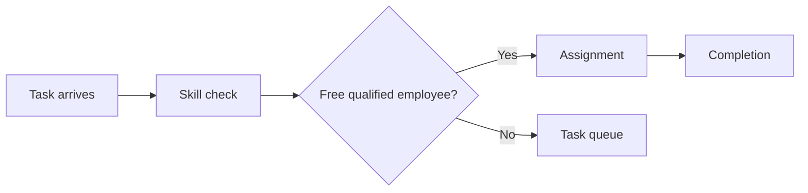
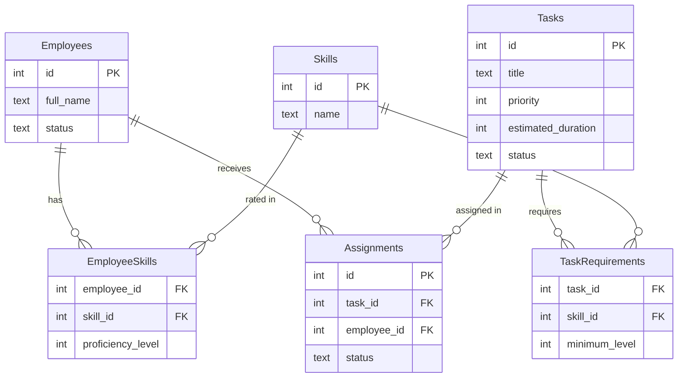

# Task Optimization System

A console application that assigns incoming tasks to employees based on their skills and availability.

This is the first-stage prototype of my diploma project, *"Developing an Application for Optimal Task Organization"*.

## Overview

In most organizations, employees have different skills at different levels, they are not always available, and new tasks keep arriving. Assigning tasks by hand means keeping all of these factors in mind at once, which leads to mistakes.

The application stores employees, their skill levels and incoming tasks. For each task, it checks whether employees meet every requirement and assigns a free, qualified employee.

> **Note:** the current assignment rule picks the free qualified employee with the lowest ID. It is a simple demonstration rule, **not** an optimal algorithm. Mathematical optimization is planned for the next stage.

## Features

- The database is created and filled with demo data automatically
- Employees with skill levels from 1 to 5
- Tasks with required skills and minimum levels
- Checks every requirement and shows the reasons when an employee doesn't qualify
- Basic assignment of a free qualified employee
- Task queue for when all qualified employees are busy
- Assignment log
- Task completion releases the employee
- Protection against assigning one employee twice

The demo database contains 6 employees, 5 skills and 8 tasks.

## How it works



1. A task is added with its required skills and minimum levels.
2. Each employee is checked against **all** requirements. If they fail even one, they are excluded.
3. A free employee is selected from the qualified ones.
4. The assignment is recorded in the log, and the employee becomes busy.
5. When the task is completed, the employee becomes available again.
6. If no qualified employee is free, the task waits in the queue.

### Example

The following example is illustrative and does not come from the demo data.

Task `TASK-001` requires Python ≥ 4 and SQL ≥ 3.

| Employee | Python | SQL | Result |
|----------|:------:|:---:|--------|
| Arman    | 5      | 3   | Suitable |
| David    | 3      | 5   | Not suitable: Python is below 4 |
| Karen    | 4      | 4   | Suitable |

## Database schema

The data is stored in SQLite in six related tables.



| Table | Purpose |
|-------|---------|
| `Employees` | Employees and their current status |
| `Skills` | List of skills |
| `EmployeeSkills` | Each employee's level in each skill (1–5) |
| `Tasks` | Tasks with priority, estimated duration and status |
| `TaskRequirements` | Minimum skill level each task requires |
| `Assignments` | Which employee works on which task |

## Getting started

### Requirements

- Python 3 (`sqlite3` is part of the standard library)

### Run

```bash
git clone <repository-url>
cd task-optimization-system
python main.py
```

